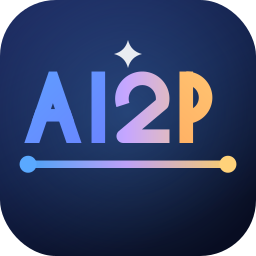
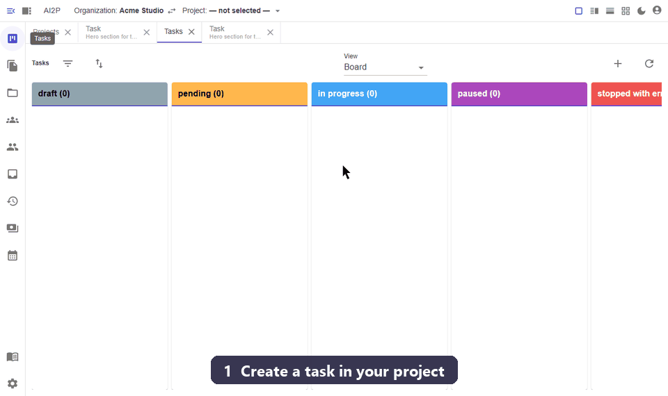
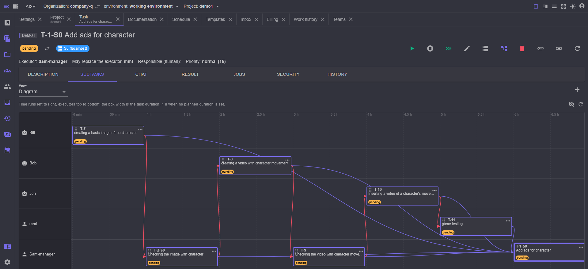
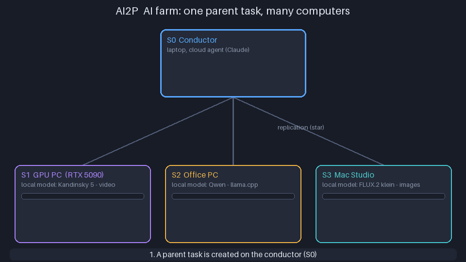

# AI2P — AI to People

### A self-hosted task planner where the executor can be an AI agent. Your Jira, where some of the cards get done by themselves.

* **Self-hosted — your data stays with you.** The database, the project files and the keys lie next to the program. Windows, Linux, macOS.
* **Any model, including local ones.** Claude, GPT, Gemini, DeepSeek, Qwen over an API, Claude Code by subscription, local models on your own video card — and a cluster of several computers.
* **People and AI in one queue.** Not "an AI agent instead of the team": the AI takes what it can do, the rest waits for people, as in any planner.

**[Quick start](man/quickstart.md)** · **[Website](https://ai2p.org/ai2p)** · **[Download](https://github.com/mmf007/AI2P/releases)** · Without an API key AI2P works as an ordinary planner for people.

Full description below ↓

 
 
 
 
 
 
 
 
 
 
 
 
 
 

---

AI2P is what Trello or Jira usually are: projects, tasks, executors, a board, a history. There is one
difference, and it changes everything: **the executor of a task may be an AI**. Whatever the AI can
do itself it does itself, at the right moment and without a reminder; the rest is left to people and
waits for them, as in any planner.

The system works **on your computer** (Windows 10–11, Linux, macOS), the interface is in the browser.
The data goes nowhere: the database, the project files and the keys lie next to the program.

## Contents

* [What it does](#what-it-does)
* [What it looks like in work](#what-it-looks-like-in-work)
* [AI2P builds itself](#ai2p-builds-itself)
* [AI farm: one task, many computers](#ai-farm-one-task-many-computers)
* [AI2P in VS Code](#ai2p-in-vs-code)
* [What is needed](#what-is-needed)
* [Quick start](#quick-start)
* [Documentation](#documentation)
* [For partners and investors](#for-partners-and-investors)
* [License](#license)

## What it does

* **It leads the work, not just a to-do list.** A task has an executor, a due date, a priority,
  acceptance criteria, blocking tasks and subtasks. Finishing a task starts the next ones by itself —
  the ones that were waiting for it.
* **It connects AI of any kind.** Text models over an API (Claude, GPT, Gemini, DeepSeek, Qwen,
  GigaChat, YandexGPT and others), Claude Code by subscription, local models on your video card, and
  also pictures, video, sound and 3D. All of them are ordinary executors: each has a nick, skills, a
  price and limits.
* **It picks an executor itself.** By the skills of the task and the "cost ↔ quality" setting of the
  project the system chooses whom to give it to — the AI first and then a person, or the other way
  round. An executor that is busy or has used up its limit is skipped, and the task waits for one to
  free up.
* **It splits big work into parts.** An agent may create subtasks and start them by priority; the
  last task of the group sums it up and, if something did not add up, returns its neighbours for
  fixing.
* **It remembers experience.** The lessons gained in the work are written down to the project, to a
  template node or to the whole organization and are put into the next job by themselves — their own
  for every skill.
* **It repeats typical processes.** A template is a tree of tasks with descriptions, skills and an
  order; a new working process is deployed out of it by a single action.
* **It works on a schedule** — from "every Monday" to the system's own actions, automatic archiving
  for example.
* **It lives on several computers.** The servers are joined into a cluster and replicate the data to
  each other; every task has an owner server on which it is carried out — that is how a local model
  computes where the video card stands.
* **It takes tasks from external systems** — Trello, GitHub, GitLab.
* **It keeps the AI within bounds.** The security rules decide what the agent is allowed to do, what
  needs a person's confirmation and what is forbidden; the agent does not go outside the project
  folder.
* **It speaks your language** — the interface, the messages and the agents' prompts are taken from
  dictionaries; the language is chosen in the `README.md` file next to the `doc/` directory

## What it looks like in work

1. You create a project and name its folder — that is where the agent will read and write files.
2. You write a task the same way you would write it for a person: the title, the description, the
   acceptance criteria.
3. You press "start". The task goes to an AI executor, its work is visible in the history, and it
   asks its questions in the task chat — and that is where you answer it.
4. The finished result lands as the task's artifact, and the task itself moves to review.

## AI2P builds itself

AI2P is developed in AI2P. More than 140 releases and hundreds of tasks: specifications,
code, tests, documentation and release builds are done by AI executors, while a human sets
the tasks and accepts the results. Every release is a task tree: an agent splits the work
into subtasks, hands them out to executors, and the final task sums up and sends back for
rework whatever did not add up. So this is not a demo on a shopping list, but a product that
proves itself on itself every day — honest agent mistakes and their fixes included.

## AI farm: one task, many computers

A local model lives where its weights and its video card are: video is computed by a gaming
PC with a powerful card, texts by a llama.cpp model on an office machine, pictures by a Mac.
The model cannot be moved, but the **work** can. AI2P needs no separate "job dispatcher" for
that — the replication the cluster already has is enough.

How it works:

1. **The computers are joined into a cluster.** One of them is the organization's conductor,
   the others connect to it ([Several servers](man/servers.md)). Tasks, chat, executors and
   experience are shared by everyone: each server replicates them with the conductor (the
   topology is a star).
2. **Every machine sets up ITS OWN executors.** An AI executor on a local model is bound to
   the server where that model is installed: "Kandinsky on S1", "Qwen on S2", "FLUX on S3".
3. **The parent task is split into subtasks.** An agent (or a template) breaks the work into
   parts — script, storyboard, video — and gives each part its own executor and an **owner
   server**: the computer where the right model is installed. A task can also be moved to
   another server with the "change server" button.
4. **Replication delivers the subtasks.** A subtask arrives at its server through the change
   log, and a hierarchy start goes to the owner as a request. Every computer runs only its own
   tasks and only with its own model — all at the same time.
5. **The results travel back.** A subtask's result, its artifacts and files are replicated to
   the other servers; once the subtasks are handed in, the parent task gathers them into one
   result and sends back for rework whatever did not add up.

What you get: one task "make a clip" loads several video cards at once, the cloud model only
does the planning, and the expensive computing runs on your own hardware for free. A computer
that is switched off stops nobody: its subtasks wait, and it catches up with the rest once it
is switched on.

What the farm does **not** do: it is not load balancing. A task runs only on its owner, and if
the owner is off, no other server picks it up by itself — you (or the agent) decide the
distribution by choosing the executor and the server of each subtask.

## AI2P in VS Code

AI2P also works inside VS Code: the project card, the workspace, settings, documentation and
task cards open as editor panels next to the project code — the same interface as in the
browser, with the theme taken from VS Code. The **AI2P** extension ships with the program
(the `ai2p-<version>.vsix` file), its version equals the AI2P version, and AI2P installs it
itself: on the **Settings** tab of the project card just press **Connect VS Code**. AI2P finds
your copy of VS Code (Insiders, VSCodium, Cursor and Windsurf too), installs the extension,
links it to the project and hands a device token to VS Code's secure storage — no secrets
are kept in the project files.

See [AI2P in VS Code](man/vscode.md) for details.

## What is needed

* Windows 10/11, Linux or macOS; administrator rights only for the installation.
* Nothing else: take the **full package** — `AI2P_v_1_NN_full_windows_x64.exe` for Windows,
  `AI2P_v_1_NN_full_linux_x64.run` for Linux, `AI2P_v_1_NN_full_macos_arm64.run` for macOS.
  Everything needed to run is inside it, there is no need to install .NET separately.
  (The package without `full` in its name is smaller, but expects the ASP.NET Core 8.x runtime to be installed already.)
* An API key of the AI you are going to use — or a Claude Code subscription, or a video card for
  local models. Without a model the system works as an ordinary planner for people.

## Quick start
For the first run in a few minutes see [Quick start](man/quickstart.md)  
[The distributions live here](https://github.com/mmf007/AI2P/releases) — take the package with `full` in its name  

## Documentation
For the detailed documentation see [Documentation](index.md)

Sections: [User guide](man/README.md) · [AI models](models/README.md) ·
[Task import](import/README.md) · [Plugins and MCP](plugins/README.md) ·
[Experience packs](packs/README.md)

## For partners and investors

If you want to contribute to the development, to launch a commercial solution based on the project or
to discuss an investment, please have a look at our
[page for partners and investors](PARTNERS.md).

## License

This project is distributed under the free **Apache License 2.0** — the full text of the terms is
available in the [LICENSE](../../LICENSE) file.
