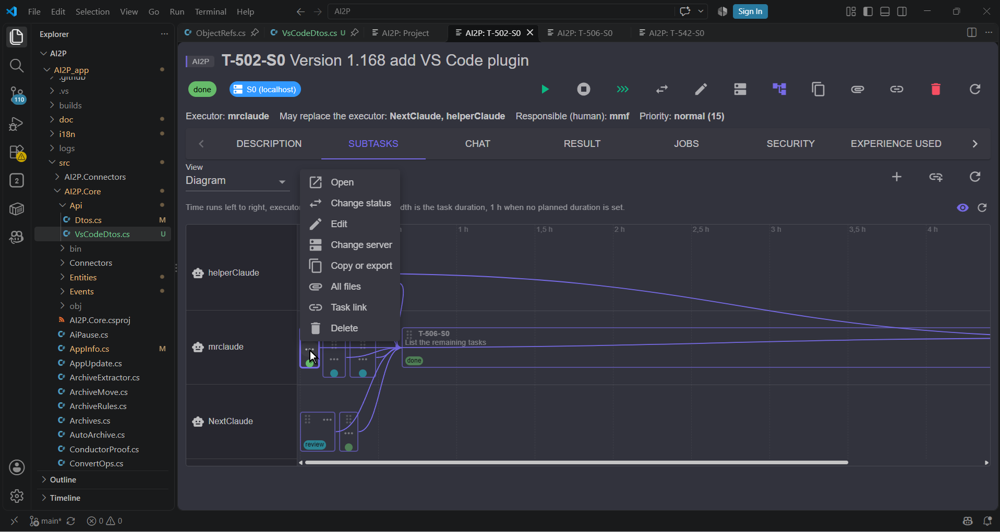

# AI2P in VS Code

AI2P can work inside VS Code: the project card, the work environment, settings, documentation
and task cards open as editor panels next to the project code. It is the same AI2P interface
as in the browser, only without the top menu, tabs, left toolbar and navigator, and the light
or dark theme is taken from VS Code.

Everything works through the **AI2P** extension for VS Code. It ships with AI2P (the file
`ai2p-<version>.vsix` in the program folder), its version always equals the AI2P version, and
AI2P installs it itself — nothing needs to be downloaded from the Marketplace.

## Requirements

* AI2P and VS Code on the **same computer**: panels talk to the server at `http://localhost`.
* The project has a **project folder** on this server. Each server has its own folder: if this server has none, VS Code cannot be connected to the
  project here and the connect buttons are not shown.
* VS Code is installed the usual way (see «Limitations»).

## Connecting a project

1. In AI2P open the project card, the **«Settings»** tab, in edit mode.
2. Press **«Connect VS Code»**. If several VS Code copies are found on the computer, a choice
   dialog appears first: pick one. The choice is remembered for this project **on this
   server** and does not travel to other servers of the cluster — different projects may use
   different copies.
3. AI2P then:
   * installs or updates the extension in the chosen VS Code copy;
   * creates `.ai2p/link.json` in the project folder — server address, organization code,
     project and server path. **There are no secrets in this file**;
   * issues a **device token** and hands it to VS Code with a `vscode://ai2p.ai2p/link` link.
     VS Code asks whether the extension may open the link — allow it. The token is kept in
     VS Code secure storage (SecretStorage), not in project files;
     The link uses the scheme of the chosen copy (`vscode-insiders://`, `vscodium://`,
     `cursor://`, `windsurf://`), so the token reaches exactly that copy;
   * following the check boxes of the connect dialog — add `.ai2p/` to `.gitignore` and open the
     project in VS Code — updates `.gitignore` and opens the project folder.

A project can also be connected when it is created: if VS Code is found and the folder is set,
the new project form has a «Connect VS Code» check box.

The extension wakes up **only** in folders that contain `.ai2p/link.json`; in other projects it
stays invisible.

The **Settings** tab shows the state even outside edit mode: "Connected to VS Code" or
"Not connected to VS Code", the name and **version** of the VS Code copy, and the
**Open project in VS Code** button. Connect, Disconnect and the copy choice are on a second
row, in edit mode only.

If there is no **AI2P** icon in the Activity Bar, the extension was not installed: the release
has no `ai2p-<version>.vsix` file (AI2P warns about it with a pop-up message when connecting).
Check it in VS Code: **Extensions** → search `ai2p`.

## First time a folder is opened: «Trust Folder»

When VS Code opens the project folder **for the first time**, it asks whether you trust its
authors (the **«Do you trust the authors of the files in this folder?»** window with the buttons
**«Yes, I trust the authors»** / **«Trust Folder»** and **«No, I don't trust the authors»**).
Until the folder is trusted, VS Code keeps it in Restricted Mode and extensions do not fully
work there.

Because of this, on the very first connection the link with the token that AI2P passes to VS Code
**is lost**: while you are reading the trust window, the extension cannot accept it yet, and the
AI2P panels do not open. What to do — **once**:

1. In the trust window click **«Yes, I trust the authors»** (**«Trust Folder»**).
2. **Close** that VS Code window (or the folder: **File → Close Folder**).
3. Click **«Open the project in VS Code»** (or **«Connect VS Code»**) in AI2P again.

Now the folder is trusted, VS Code no longer asks, the link gets through and the project opens
right away. There is no need to repeat this for the same folder — only for each new project folder.

## Menu and panels

An **AI2P** icon appears in the Activity Bar on the left. Its menu has four items:

| Item | Opens |
|---|---|
| **Project** | the project card |
| **Environment** | the work environment and archives (shown only if archives exist) |
| **Settings** | AI2P settings |
| **Documents** | this documentation |

The same actions are in the command palette (`Ctrl+Shift+P`) with the **«AI2P:»** prefix:
«AI2P: Project», «AI2P: Environment», «AI2P: Settings», «AI2P: Documents», «AI2P: Open
Task…», «AI2P: Connect Project from AI2P», «AI2P: Disconnect VS Code», «AI2P: Start Server»,
«AI2P: Check for Extension Update». The labels are translated into the five AI2P languages and
follow the VS Code language.

Each item opens one panel: choosing it again brings the open panel to the front. A **task**
selected in any panel (tree, board, table, diagram, Inbox, a link in text) opens in a
**separate panel** alongside — a single-task card. VS Code restores open panels after a restart.

**Theme.** The light or dark theme comes from VS Code and changes on the fly in all open
panels when you switch the editor theme. It does not change your AI2P theme in the browser.

**Language.** Panels use the VS Code language if it is one of the AI2P languages (Russian,
English, Spanish, Portuguese, Chinese); otherwise the AI2P installation language.

## The AI2P server

If the server is not running, the extension starts it when the first panel opens — once per
computer, even with several VS Code windows. The server lives apart from VS Code: closing the
editor does not stop it.

If the server is restarted, the panels wait for it and reload by themselves — no need to press
anything.

## Sign-in and token revocation

Panels have no sign-in form: VS Code signs in with the **device token** issued on connection,
on behalf of the person who pressed «Connect VS Code» and with that person's rights. The token
works only on this server.

Your tokens are listed in AI2P: **Settings → «Notifications» → «My devices (VS Code)»** — device,
project, issue date and last sign-in. **«Revoke»** closes access: on the next request the panel
shows «VS Code needs to be connected». Everyone sees and revokes only their own tokens.

## Disconnecting

On the project «Settings» tab press **«Disconnect VS Code»**: AI2P deletes `.ai2p/link.json` and
revokes all your tokens for this project. The extension itself stays — it is shared by all
projects.

The palette command **«AI2P: Disconnect VS Code»** erases the token only on this computer; to
close it on the server as well, revoke the token in «My devices».

## Updating the extension

The extension is updated together with AI2P:

* at start-up the server checks the extension version in every remembered VS Code copy and,
  if it is behind, installs the new one in the background;
* the extension itself compares its version with the server version at start-up and, if it is
  behind, offers **«Update»**; after the update VS Code asks to reload the window (Reload Window).

To check manually use «AI2P: Check for Extension Update».

## Limitations

* **localhost over HTTP only.** VS Code panels do not accept a self-signed certificate, so even
  on an HTTPS server the embedded mode uses `http://localhost`. VS Code cannot be connected to a
  server on another computer.
* **VS Code forks** (VS Code Insiders, VSCodium, Cursor, Windsurf) are detected and can be
  chosen, but only regular VS Code has been tested.
* **macOS and Linux.** The extension has been tested on Windows, macOS and Linux.
* If the computer went to sleep or the network dropped while the server kept running, a panel
  may show the reconnect window longer than usual; close and reopen the panel.
* Sign-in windows and forms that need a regular sign-in do not work inside panels: sign-in is
  by token only.
